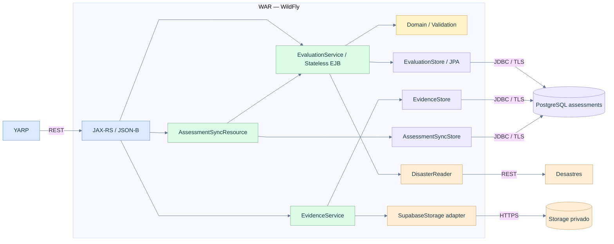
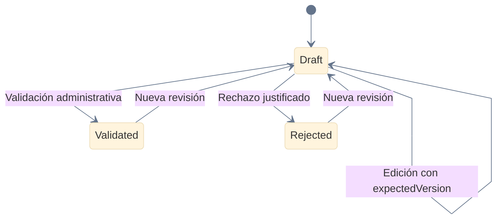
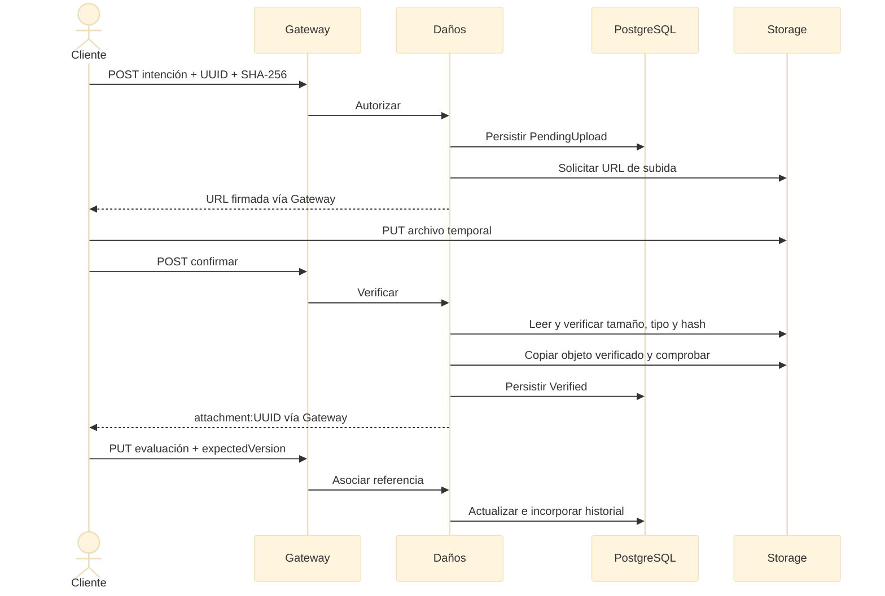

<div align="center">

# RECONECTA

### Damage Assessment

**De la emergencia a la reconstrucción**

Servicio de evaluación, revisión y validación de daños.


**Pontificia Universidad Javeriana**

Arquitectura de Software · 2026

[Plataforma completa](https://github.com/disaster-management-platform/disaster-platform-infrastructure) · [Arquitectura](#arquitectura) · [Demostración](#demostración) · [Instalación](#instalación-y-ejecución)

</div>

---

## Demostración

<div align="center">

[](https://youtu.be/HVCKoTRAxu8)

[Ver demostración funcional de RECONECTA](https://youtu.be/HVCKoTRAxu8)

</div>

## Descripción

`disaster-damage-assessmet-service` registra el estado de activos afectados, sus presupuestos estimados, evidencias y revisiones. Es el propietario del dominio de daños. Un único WAR integra JAX-RS, JSON-B, EJB sin estado, CDI, JPA y JTA sobre WildFly. La aplicación web y Android consumen sus contratos REST; Reconstrucción utiliza snapshots de evaluaciones vigentes para determinar elegibilidad.

## Contenido

- [Funcionalidades](#funcionalidades)
- [Arquitectura](#arquitectura)
- [Decisiones arquitectónicas](#decisiones-arquitectónicas)
- [Tecnologías y justificación](#tecnologías-y-justificación)
- [Estructura del repositorio](#estructura-del-repositorio)
- [Integración con otros componentes](#integración-con-otros-componentes)
- [Persistencia](#persistencia)
- [Contratos de comunicación](#contratos-de-comunicación)
- [Seguridad](#seguridad)
- [Instalación y ejecución](#instalación-y-ejecución)
- [Pruebas](#pruebas)
- [Alcance y validación](#alcance-y-validación)
- [Repositorios relacionados](#repositorios-relacionados)
- [Autores](#autores)

## Funcionalidades

| Funcionalidad | Descripción |
| --- | --- |
| Evaluaciones | Registro preliminar o asociado a desastre, tipo de activo, categoría, ubicación y presupuesto COP. |
| Validación | Draft, Validated y Rejected; nuevas revisiones conservando identidad. |
| Catálogos | Alta y desactivación sin eliminar referencias históricas. |
| Mapa | Coordenadas WGS84 y geometrías GeoJSON validadas. |
| Evidencias | Intenciones de subida, verificación, referencias y descargas autorizadas. |
| Sincronización | Batch independiente por operación y Delta por cursor con invalidaciones. |

## Arquitectura

### Vista lógica




### Responsabilidades de los componentes

| Componente | Responsabilidad |
| --- | --- |
| EvaluationsResource | Contratos de creación, edición, catálogo, estado e historial. |
| EvaluationService | Reglas de activo, asociación, revisión y validación. |
| EvidenceService | Intenciones, confirmación y capacidad de verificación. |
| AssessmentSyncResource | Batch y Delta. |
| EvaluationStore / EvidenceStore / AssessmentSyncStore | Persistencia local del servicio mediante JPA/JTA. |
| DisasterReader | Verifica el desastre por contrato REST. |
| SupabaseStorage | Adaptador HTTP de objetos privados. |

### Vista de procesos

WildFly ejecuta el WAR y administra instancias EJB stateless, transacciones JTA y el pool JDBC JNDI. Cada réplica tiene su propio pool (máximo predeterminado 8). Desastres y Storage se consultan fuera de las transacciones JTA que modifican metadatos.

### Ciclo de vida


### Secuencia de evidencias (Valet Key)


La confirmación de evidencia no modifica automáticamente la evaluación. El archivo definitivo permanece inmutable. También existe compatibilidad multipart, que utiliza la misma intención y confirmación. JPEG, PNG y PDF: máximo 6 MiB por defecto; descarga autorizada mediante URL firmada de 60 segundos.

## Decisiones arquitectónicas

| Atributo de calidad | Decisión | Mecanismo y compromiso |
| --- | --- | --- |
| Modificabilidad | Capas Jakarta EE | Separación API/BLL/persistencia; exige servidor compatible. |
| Integridad | JTA y @Version | Historial y estado se guardan conjuntamente; rechaza escrituras obsoletas. |
| Resiliencia | Idempotencia / Valet Key | Recibo original, leases y reconciliación de objetos; no hay transacción distribuida. |
| Escalabilidad | EJB stateless y pool | Ajuste por réplica; dimensionar capacidad total de PostgreSQL. |
| Interoperabilidad | REST / OpenAPI | Snapshots canónicos consumibles por .NET y Kotlin. |
| Disponibilidad | Batch y Delta | Operaciones independientes y cursores; exige dependencia remota para asociar desastres. |

## Tecnologías y justificación

| Tecnología | Justificación para la integración |
| --- | --- |
| Java 21 / Jakarta EE 11 | Contratos y componentes estándar empresariales interoperan con .NET mediante REST. |
| WildFly 42 | Administra EJB, CDI, JNDI, pools y JTA; concentra mecanismos de ejecución sin desarrollarlos manualmente. |
| JAX-RS / JSON-B | Expone DTOs y OpenAPI independientes de los modelos de persistencia de otros servicios. |
| JPA / Hibernate / PostgreSQL JDBC 42.7.7 | Mapeo relacional, concurrencia optimista y transacciones sobre el esquema assessments. |
| JTS | Validación de geometrías interoperables GeoJSON; no sustituye un sistema GIS. |
| Supabase Storage | Separa archivos binarios de metadatos; URL firmada evita entregar credenciales de servicio al cliente. |
| MicroProfile JWT | Valida tokens del mismo proveedor que los servicios .NET. |
| Docker / Maven | WAR reproducible y runtime Java aislado dentro de la plataforma. |

## Estructura del repositorio

```text
disaster-damage-assessmet-service/
├── src/main/java/platform/damage/
│   ├── api/
│   ├── business/
│   ├── domain/
│   ├── persistence/
│   └── storage/
├── src/main/resources/META-INF/openapi.json
├── migrations/                   # V001 a V005
├── server/                       # datasource.cli, permissions.sql, storage.sql
├── scripts/                      # integration, persistence, evidence, sync
├── tests/OAuthChecks.java
├── pom.xml
└── Dockerfile
```

## Integración con otros componentes

Desastres valida referencias de desastre por REST y Client Credentials. Reconstrucción consulta el snapshot `schemaVersion: 1`, con una evaluación vigente por activo y desastre; solo una evaluación actual Validated con daño distinto de None es elegible. Android sincroniza mediante Batch y Delta y transfiere archivos usando URLs firmadas; el portal consume los contratos a través de YARP. No existen claves foráneas a tablas de otros dominios.

## Persistencia

El esquema `assessments` conserva evaluaciones, catálogos, historial inmutable, recibos y evidencia. V001–V005 se aplican explícitamente; Hibernate valida el esquema al arrancar. JPA `@Version` protege actualizaciones; `revision` distingue revisiones funcionales. El recibo original no cambia después de una edición. El cursor Delta queda ligado a actor, organización, permisos y desastre, expira en siete días y contiene invalidaciones de recursos que salen del ámbito. Los objetos se almacenan en Storage privado; solo las copias temporales expiradas se limpian de forma oportunista y acotada.

## Contratos de comunicación

| Método | Ruta | Responsabilidad |
| --- | --- | --- |
| GET / POST | `/api/evaluaciones` | Snapshot / creación idempotente. |
| GET / PUT | `/api/evaluaciones/{id}` | Detalle / edición Draft. |
| PUT | `/api/evaluaciones/{id}/desastre` | Asociar preliminar. |
| PUT | `/api/evaluaciones/{id}/estado` | Validar o rechazar. |
| POST | `/api/evaluaciones/{id}/revisiones` | Nueva revisión. |
| GET | `/api/evaluaciones/{id}/historial` | Auditoría. |
| GET | `/api/evaluaciones/mapa` | Snapshot geográfico. |
| GET | `/api/evaluaciones/catalogos` | Catálogos. |
| POST | `/api/evaluaciones/catalogos/tipos-activo` y `/categorias-dano` bajo el mismo prefijo | Altas administrativas. |
| PUT | `/api/evaluaciones/catalogos/{tipo}/{id}/desactivar` | Desactivar catálogo. |
| POST | `/api/evaluaciones/batch` | Lote máximo 50 por defecto. |
| GET | `/api/evaluaciones/sync` | Delta por cursor. |
| GET / POST | `/api/evaluaciones/{id}/evidencias` | Listado / intención. |
| GET | `/api/evaluaciones/{id}/evidencias/{file}` | Metadatos. |
| POST | `/api/evaluaciones/{id}/evidencias/{file}/confirmar` | Verificar. |
| GET | `/api/evaluaciones/{id}/evidencias/{file}/descarga` | URL firmada. |
| GET | `/api/evaluaciones/openapi` | Contrato OpenAPI. |
| GET | `/api/evaluaciones/diagnostico/live` y `/ready` bajo el mismo prefijo | Diagnóstico. |
La creación requiere `Idempotency-Key` UUID; cambios usan `expectedVersion`. Batch devuelve resultados independientes, sin aceptación asíncrona ni transacción global. El presupuesto se expresa en COP con dos decimales; desconocido no equivale a cero.

## Seguridad

MicroProfile JWT valida firma, issuer, audiencia, expiración y claims. Roles `damage.read`, `damage.write`, `damage.admin`; `reconstruction.read/write` permiten snapshots autorizados, no modificar daños. Preliminares visibles únicamente a la organización evaluadora; escrituras requieren pertenecer a ella. La lectura por desastre autorizado puede incluir evaluaciones de otros organismos. El rol PostgreSQL `damage_assessment_api` no administra el esquema ni puede modificar el historial. Las llamadas a Desastres usan credenciales técnicas independientes. Storage aplica acceso privado y verificación de hash, tamaño y formato; no constituye un antivirus.

## Instalación y ejecución

Para ejecutar la plataforma completa, consultar [Infrastructure](https://github.com/disaster-management-platform/disaster-platform-infrastructure).

```bash
git clone https://github.com/disaster-management-platform/disaster-damage-assessmet-service.git
cd disaster-damage-assessmet-service
```
Requiere Java 21, Maven, WildFly 42 o Docker, PostgreSQL y configuración de identidad. Aplicar V001–V005 en orden solo si faltan, con rol migrador y respaldo previo. Ejecutar `server/permissions.sql` y aprovisionar el bucket y su política según `server/storage.sql`. Para el DataSource `java:jboss/datasources/DamageAssessment` utilizar `server/datasource.cli` con variables `DAMAGE_DB_HOST`, `DAMAGE_DB_PORT`, `DAMAGE_DB_NAME`, `DAMAGE_DB_USER`, `DAMAGE_DB_PASSWORD`, `DAMAGE_DB_CA` y pool configurado. JDBC usa `sslmode=verify-full`. Configurar `DISASTERS_BASE_URL` y `DISASTERS_OAUTH_TOKEN_ENDPOINT`, `DISASTERS_OAUTH_CLIENT_ID`, `DISASTERS_OAUTH_CLIENT_SECRET` y propiedades `mp.jwt.verify.*`. Todos los secretos son externos.

```bash
mvn clean package
docker build -t disaster-damage-assessmet-service:local .
```

Para instalación nativa en WildFly iniciado, con las variables cargadas:

```bash
mvn dependency:get -Dartifact=org.postgresql:postgresql:42.7.7
"$WILDFLY_HOME/bin/jboss-cli.sh" --connect --command="deploy $HOME/.m2/repository/org/postgresql/postgresql/42.7.7/postgresql-42.7.7.jar"
"$WILDFLY_HOME/bin/jboss-cli.sh" --connect --file=server/datasource.cli
"$WILDFLY_HOME/bin/jboss-cli.sh" --connect --command="deploy target/damage-assessment.war"
```

El WAR utiliza el contexto raíz. En el despliegue integrado debe ejecutarse separado de Integration Service.

## Pruebas

| Prueba | Alcance |
|---|---|
| `integration_test.py` | Contratos, roles, revisión y propietario remoto. |
| `persistence_test.py` | Dos instancias, idempotencia, concurrencia y rollback. |
| `evidence_test.py` | Intenciones, copia verificada y recuperación. |
| `sync_test.py` | Batch, Delta, invalidaciones y cursor. |
| `tests/OAuthChecks.java` | Credenciales técnicas y renovación. |

```bash
mvn package
DAMAGE_TEST_URL=http://127.0.0.1:8170 \
DISASTERS_TEST_URL=http://127.0.0.1:8198 \
DAMAGE_TEST_KEY=/ruta/privada/pruebas.pem \
python3 scripts/integration_test.py
```

Usar servicios aislados, base local y par de claves de prueba externo; issuer `https://identity.test`, audiencia `platform` para ese escenario. Los scripts de persistencia y evidencia requieren `DAMAGE_TEST_URLS`, `DAMAGE_TEST_KEY` y, cuando corresponda, `DAMAGE_TEST_POSTGRES_CONNECTION` local. Configurar Storage dedicado con datos sintéticos para evidencias. Nunca usar metadatos de entrega. No se ejecutaron pruebas nuevas.

## Alcance y validación

La interoperabilidad se basa en el contrato REST existente, no en una transacción distribuida con Reconstrucción. La evidencia se verifica y asocia en etapas; pueden existir objetos temporales pendientes. La integración móvil de Daños está disponible en Debug en el código consultado.

Referencia del código consultado: [`8cf622d`](https://github.com/disaster-management-platform/disaster-damage-assessmet-service/tree/8cf622d3e5cb2031fa89b04b878472de9196f0b5). Los resultados cuantitativos de los atributos de calidad requieren experimentos sobre el despliegue integrado.

## Repositorios relacionados

| Repositorio | Responsabilidad |
| --- | --- |
| [Infrastructure](https://github.com/disaster-management-platform/disaster-platform-infrastructure) | Despliegue integral |
| [Presentation](https://github.com/disaster-management-platform/disaster-platform-presentation) | Portal Razor MVC |
| [Mobile Client](https://github.com/disaster-management-platform/disaster-mobile-client) | Android Offline First |
| [API Gateway](https://github.com/disaster-management-platform/disaster-api-gateway) | Enrutamiento YARP |
| [Disaster Management](https://github.com/disaster-management-platform/disaster-backend-offline) | Gestión de desastres |
| [Integration Service](https://github.com/disaster-management-platform/disaster-integration-service) | Interoperabilidad y ACL |
| [Reconstruction](https://github.com/disaster-management-platform/reconstruction-business-layer) | Proyectos de reconstrucción |
| [Sahana Eden](https://github.com/disaster-management-platform/sahana-eden) | Gestión humanitaria nativa |
| [Platform DAL](https://github.com/disaster-management-platform/disaster-platform-dal) | Bibliotecas de persistencia y contratos |

## Autores

<div align="center">

**Pontificia Universidad Javeriana**

Facultad de Ingeniería — Departamento de Ingeniería de Sistemas

Arquitectura de Software · 2026-30

| Integrantes |
|:---:|
| Juan Felipe Rodríguez |
| Viviana Gómez León |
| Valeria Catalina Caycedo Ramírez |
| Sofía Guerra Jiménez |

**Docente:** César Julio Bustacara Medina

---

### RECONECTA

*De la emergencia a la reconstrucción.*

</div>